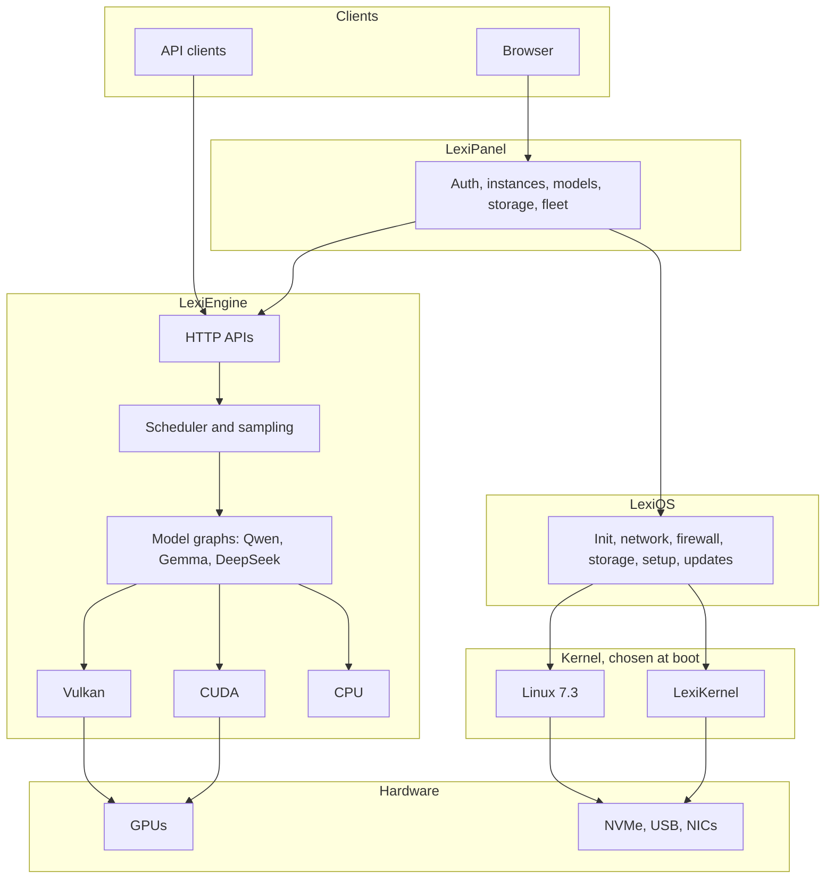

<div align="center">

# LexiSuite

### OS / Kernel / Engine / Panel. All Rust.

A complete local inference stack, from the kernel that boots the machine to the browser
panel that runs it. Your hardware, your models, nothing in the cloud.


[Overview](#overview) •
[Architecture](#architecture) •
[Performance](#performance) •
[Models](#models) •
[Quick start](#quick-start) •
[API](#api) •
[Hardware](#hardware) •
[Status](#status) •
[License](#license)

</div>

---

[All-In-One Image Download [https://github.com/W61k3r/LexiSuite-Releases/releases/download/LexiSuitet3/LexiSuite-testing6.img.xz]](https://github.com/W61k3r/LexiSuite-Releases/releases/download/LexiSuitet6/LexiSuite-051033e-secureboot-dev.img.xz)

## Overview

LexiSuite is four products built to work as one system:

| Component | What it is | Where |
|---|---|---|
| **LexiEngine** | Native Rust inference server: GGUF models on Vulkan, CUDA and CPU, with compatible HTTP APIs | [`lexipanel-rs/engine`](lexipanel-rs/engine) |
| **LexiPanel** | Authenticated browser control plane for models, instances, GPUs, storage and fleets | [`lexipanel-rs`](lexipanel-rs) |
| **LexiOS** | Rust-first appliance OS on Linux 7.3: init, network, firewall, storage, setup, updates | [`lexios`](lexios) |
| **LexiKernel** | Rust kernel with a Linux ABI, built around inference workloads | [`lexios/lexikernel`](lexios/lexikernel) |

Why build the whole stack:

- **It's fast on real cards.** On the 7900 XTX with draft-head speculation, LexiEngine is level with or ahead of
  llama.cpp on every 27B row measured on 11/03/2026, up to 30% faster, and processes prompts up to 22% faster.
  See [Performance](#performance).
- **One Rust codebase.** 1.77 million lines across 324 crates, from boot code to the browser UI.
- **Local by design.** Models, prompts and data stay on your machine.
- **It boots from a stick.** A development USB image carries Linux 7.3 and LexiKernel side by side, and LexiKernel
  has booted real hardware and served the Panel from it.

---

## Architecture



### Repository layout

```text
.
├── lexipanel-rs/
│   ├── crates/
│   │   ├── lexi/            Panel server and CLI tools
│   │   ├── lexi-gui/        Browser UI, compiled to WebAssembly
│   │   ├── installer/       Panel installer
│   │   ├── lexi-debugkit/   Support and boot diagnostics
│   │   ├── lexi-guard/      Tool permission gate
│   │   ├── lexi-hwinfo/     Hardware inventory
│   │   ├── lexi-vm/         VM support
│   │   └── xtask/           Build and release tasks
│   ├── engine/              LexiEngine workspace, 159 crates
│   ├── deploy/              Install scripts and packaging
│   └── third-party-licenses/
├── lexios/
│   ├── lexikernel/          LexiKernel: 99 crates
│   │   ├── crates/          Kernel subsystems
│   │   └── drivers/         NVMe, AHCI, xHCI, USB, virtio, NICs, GPU blocks
│   ├── tools/               LexiOS userland, 52 crates
│   ├── .lexios/             Policies, configuration, fixtures
│   └── third-party-licenses/
├── docs/                    Binary test fixtures read by the test suites
├── experimental/            Research code, not shipped
└── tools/                   Build helpers
```

---

## Performance

Qwen3.8 27B on a Radeon RX 7900 XTX, measured on 11/03/2026 against llama.cpp on the same machine in the same
session: LexiEngine from commit `a7df5635`, llama.cpp b11954 (Vulkan, flash attention). Intel i7-9700, XTX capped
at 291 W, Linux 7.3. Both use a Q4_1 KV cache and a 131,072-token context. Each prompt carries a random prefix,
so nothing is served from a cache.

`short` is "What is 2+2? Answer with just the number.", up to 64 tokens, three runs. `3.6k` and `20k` are prompts of
3,628 and 20,971 tokens, then up to 32 tokens. Generation is tokens per second after the first token; each figure
is the median of its runs. Draft-head speculation (MTP) proposes two tokens on both engines.

### 7900 XTX: Qwen3.8 27B IQ4_XS

| Row | LexiEngine | llama.cpp | |
|---|---:|---:|---|
| MTP, short | **72.3** | 62.4 | **+16%** |
| MTP, 3.6k | 77.0 | 76.0 | level |
| MTP, 20k | 66.8 | 66.8 | level |
| Prompt, 3.6k (tok/s) | **920** | 756 | **+22%** |
| Prompt, 20k (tok/s) | **844** | 712 | **+19%** |
| First token, 3.6k | **3.9 s** | 4.8 s | **18% sooner** |
| First token, 20k | **24.9 s** | 29.4 s | **16% sooner** |
| No MTP, short / 3.6k / 20k | 38.1 / 37.7 / 34.7 | 39.0 / 40.7 / 38.4 | 2 to 10% behind |

### 7900 XTX: Qwen3.8 27B Q4_K_M

| Row | LexiEngine | llama.cpp | |
|---|---:|---:|---|
| MTP, short | **69.4** | 59.9 | **+16%** |
| MTP, 3.6k | **69.9** | 55.7 | **+25%** |
| MTP, 20k | **68.3** | 52.6 | **+30%** |
| Prompt, 3.6k (tok/s) | **875** | 727 | **+20%** |
| Prompt, 20k (tok/s) | **804** | 679 | **+18%** |
| First token, 3.6k | **4.2 s** | 5.0 s | **17% sooner** |
| First token, 20k | **26.1 s** | 30.9 s | **16% sooner** |
| No MTP, short / 3.6k / 20k | 34.6 / 33.4 / 30.8 | 34.7 / 34.0 / 34.4 | level to 11% behind |

With draft-head speculation, the way the Panel runs it, LexiEngine is level with or ahead of llama.cpp in every row,
and its prompt processing is faster in every mode. Plain generation at long context is the remaining gap.
Other models and the RTX 2060 have not been re-measured on this commit, so they are not listed here.

### 7900 XTX: Qwen3 1.7B Q4_K_M, LexiOS from the USB image

Measured on 11/04/2026 (UTC) on a second 7900 XTX (Ryzen 9 5900X), LexiOS on Linux 7.3 booted from the USB stick,
through the Panel over the network. Same model and settings on both engines: 8,192-token context, f16 KV cache,
one slot, 256 generated tokens, three runs each. llama.cpp b12090 (Vulkan) installed by the Panel's engine installer.

| | LexiEngine | llama.cpp b12090 |
|---|---:|---:|
| Generation, short prompt | 257-264 tok/s | 342-344 tok/s |
| Generation, 3,586-token prompt | 236-237 tok/s | 294-295 tok/s |
| First token, 3,586-token prompt | 0.84-0.90 s | 0.59-0.63 s |
| First token, short prompt | 0.04 s | 0.16-0.20 s |

On small models llama.cpp is 25-30% faster: at this speed LexiEngine's fixed per-token cost dominates. This is the
next performance target.

---

## Status, 11/04/2026

- USB release image built from this source: 3 GiB, no models. On first boot the LEXIDATA partition and filesystem
  grow to fill the stick under either kernel (verified on a 32 GiB disk in a VM: Linux 7.3 and LexiKernel both reach
  a working Panel). Not yet verified on a physical stick.
- The image is signed with a development owner key, not a production key. With Secure Boot on, LexiKernel refuses
  to start until that certificate is enrolled.
- LexiKernel: the Intel I219 network driver now completes the PHY low-power exit and logs link and DHCP events;
  the ThinkPad P71 gets its address within a second on two consecutive boots. The console does not yet show
  LEXIDATA free space.
- LexiKernel GPU: a native Rust AMD Navi 31 (RDNA3) driver has been integrated as offline software (firmware boot,
  power, GPU memory, interrupts, compute queues, copy engines, reset, DRM render-node backend) and passes its mock
  and kernel test suites. It has not run on hardware; GPU work under LexiKernel still uses the Linux driver-domain
  guest. Vulkan on the native driver is not yet available.
- Panel: every tab, including System, is served inside the one shared Panel shell.

---

## Models

Architectures served per backend, as reported by `lexi-engine --accelerator-capabilities-json`:

| Architecture | CPU | Vulkan | CUDA |
|---|:-:|:-:|:-:|
| Qwen3 | Yes | Yes | Yes |
| Qwen3.5 / 3.8 hybrid | Yes | Yes | Yes |
| Gemma 4 | Yes | Yes | Yes |
| DeepSeek-V2 | Yes | Yes | Yes |

Measured here: Q4_K_M, IQ4_XS, Q8_0 and F16. Speculative decoding uses
the draft head embedded in MTP models. Also in the tree, at earlier stages: embeddings and reranking,
vision, speech, image generation and native quantization tools.

---

## Install from the USB image

1. Download `LexiSuite-testing.img.xz` from [Releases](../../releases) and check it against `SHA256SUMS`.
2. Write it to a USB stick of 8 GB or more with balenaEtcher or Raspberry Pi Imager (both take the `.xz` directly), or
   `xz -dc LexiSuite-testing.img.xz | sudo dd of=/dev/sdX bs=4M conv=fsync` (this erases the stick).
3. Boot from the stick. Choose LexiKernel or Linux 7.3 at the menu. On first boot the data partition grows to fill
   the stick.
4. Open the Panel address shown on the screen (port 8090) and create the administrator account.

The image has no models; add one from the Panel. LexiKernel needs an Intel machine with VT-d on and Secure Boot off
(development signing). Linux 7.3 runs on most x86-64 PCs.

## API

LexiEngine speaks the APIs existing clients already use.

| Endpoint | Purpose |
|---|---|
| `POST /v1/chat/completions` | Chat, streaming or not |
| `POST /v1/completions` | Text completion |
| `POST /v1/responses` | Responses API |
| `POST /v1/messages` | Messages API, with `count_tokens` |
| `POST /v1/embeddings` | Embeddings |
| `POST /v1/rerank` | Reranking |
| `POST /v1/images/generations` | Image generation |
| `GET /v1/models` | Loaded models |
| `GET /health` | Health |
| `GET /metrics` | Metrics |

```bash
curl http://127.0.0.1:8080/v1/chat/completions \
  -H 'Content-Type: application/json' \
  -d '{"model":"local","stream":true,"messages":[{"role":"user","content":"Hello"}]}'
```

A request larger than the context window gets an HTTP 400 stating the reason, and the server keeps serving.

---

## Hardware

### Tested GPUs

| GPU | API | Result |
|---|---|---|
| Radeon RX 7900 XTX | Vulkan | Primary target, every row above |
| GeForce RTX 2060 | CUDA | Supported; not re-measured on this commit |
| Intel UHD 630 / Gen9 | Vulkan | Engine runs through ANV |

### LexiKernel requirements

- x86-64 with an active IOMMU: Intel VT-d or AMD-Vi. There is no boot without one, by design.
- xHCI USB.
- A supported network device, plugged in before boot.

| Driver | Devices | Proven on |
|---|---|---|
| `intel-nic` | e1000, e1000e, igb | QEMU, both IOMMU types, load tested |
| `intel-nic` | I219 | ThinkPad P71, real hardware (11/03/2026) |
| `intel-nic` | I225 (igc) | Written, not yet run |
| `virtio` | virtio net and block | QEMU, both IOMMU types, load tested |
| `usb-class` | USB Ethernet (CDC ECM, NCM) | QEMU `usb-net` on ECM. NCM not yet run |
| `realtek-nic` | RTL8125B 2.5G, RTL8168/8169 | Emulated chip in unit tests only |
| `xhci`, `usb-class` | USB host and USB storage | ThinkPad P71, real hardware (11/03/2026) |
| `nvme`, `ahci` | Storage | QEMU |

The 2.5G RTL8125B driver runs on the chip's built-in microcode, and refuses other RTL8125 revisions.

---

## Security model

- **IOMMU required.** Network drivers refuse to bind without isolated DMA.
- **Rust first.** 308 of 374 crate roots forbid `unsafe` outright.
- **Fail closed.** Unknown hardware revisions and unsupported shapes are refused, not guessed at.
- **Authenticated Panel.** One-time setup code, CSRF and origin checks on mutating requests.
- **Key-only SSH on development images.** The build carries a public key only. Release images refuse the option.
- **Build-neutral binaries.** Release builds remap paths, and media builds are scanned for private strings.

---

## Status

**LexiSuite is in active development and is not a generally available release.** This section is kept honest on purpose.

### Last test runs

On commit `e753de1`, 11/05/2026, all passing:

| Suite | Passed | Failed |
|---|---:|---:|
| LexiEngine workspace | 3,724 | 0 |
| LexiEngine server | 521 | 0 |
| LexiPanel | 2,106 | 0 |
| LexiPanel integration | 68 | 0 |
| LexiOS tools | 1,083 | 0 |
| LexiKernel core, PCI and xHCI | 627 | 0 |
| Linux ABI | 287 | 0 |

### Proven

- Qwen3.8 27B on the 7900 XTX at or above llama.cpp speed with draft-head speculation (see [Performance](#performance)).
- **LexiKernel boots on real hardware.** On 11/03/2026 it booted a Lenovo ThinkPad P71 (i7-7700HQ) from USB, brought
  up the network, served the Panel to another machine and showed the local console.
- On LexiKernel, the Panel's Start button runs the engine and a chat completes, in QEMU with the same CPU flags as
  that laptop.
- Linux 7.3 and LexiKernel boot from one image.

### Not yet proven

- GPU inference on LexiKernel on real hardware. LexiKernel drives GPUs only through a Linux guest in QEMU so far.
- The RTL8125B driver has never run on a real chip.

### Known gaps

- Plain generation (no draft head) at long context trails llama.cpp by up to 11% on the 27B.
- LexiKernel runs all of a process's threads on one CPU, so CPU inference there is far slower than on Linux.
- Most of the Panel's System pages call Linux tools that LexiKernel doesn't provide yet, and one engines page stops
  the Panel there until it restarts.
- A client disconnect doesn't yet cancel a non-streaming request.

---

## License

Free for public, private, personal and educational use. Commercial use is **US$100 per instance per year**, which
includes support and priority fixes for problems specific to your hardware and setup. There are no licence keys or
usage checks: commercial users are trusted to buy what they use. The source code remains proprietary. See
[LICENSE](LICENSE).

Copyright (c) 2026 LexiPanel.

Third-party components keep their own licences. See [`lexios/THIRD_PARTY_NOTICES.md`](lexios/THIRD_PARTY_NOTICES.md),
[`lexipanel-rs/engine/THIRD_PARTY_NOTICES.md`](lexipanel-rs/engine/THIRD_PARTY_NOTICES.md) and the
`third-party-licenses` directories. Linux 7.3, included in LexiOS images, is licensed under GPL-2.0.

<div align="center">

**OS / Kernel / Engine / Panel. All Rust.**

</div>
