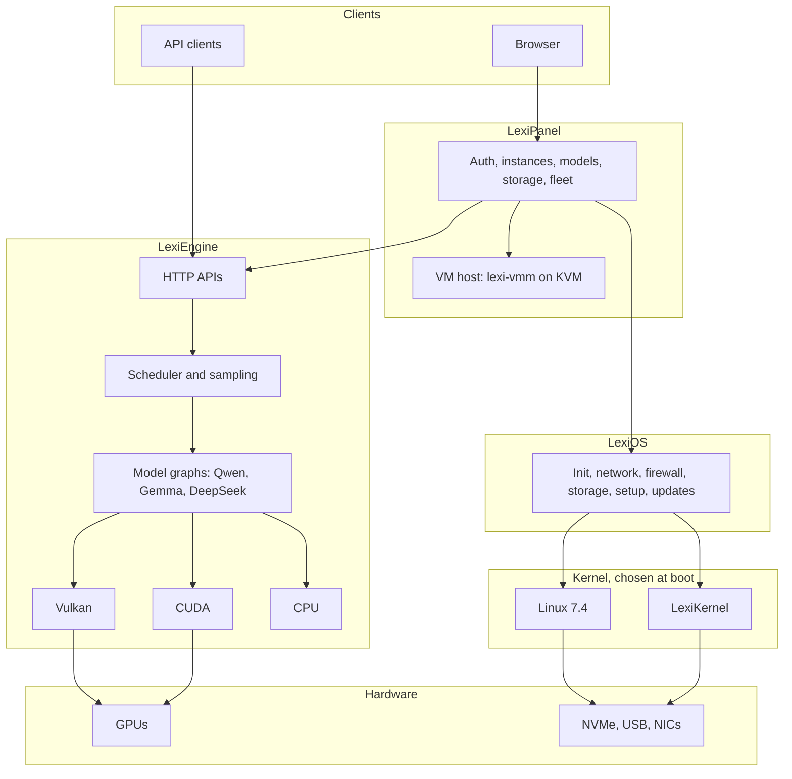

<div align="center">

# LexiSuite

DOWNLOAD LINK
https://github.com/W61k3r/LexiSuite-Releases/releases/download/LexiSuiteT7/LexiSuite-1c5fa3c-secureboot-dev.img.xz

### OS / Kernel / Engine / Panel. All Rust.

A complete local inference stack, from the kernel that boots the machine to the browser
panel that runs it. Your hardware, your models, nothing in the cloud.


[Overview](#overview) •
[Architecture](#architecture) •
[Performance](#performance) •
[Models](#models) •
[Quick start](#quick-start) •
[API](#api) •
[Hardware](#hardware) •
[Status](#status) •
[License](#license)

</div>

---

## Overview

LexiSuite is four products built to work as one system:

| Component | What it is | Where |
|---|---|---|
| **LexiEngine** | Native Rust inference server: GGUF models on Vulkan, CUDA and CPU, with compatible HTTP APIs | [`lexipanel-rs/engine`](lexipanel-rs/engine) |
| **LexiPanel** | Authenticated browser control plane for models, instances, GPUs, storage, fleets and virtual machines | [`lexipanel-rs`](lexipanel-rs) |
| **LexiOS** | Rust-first appliance OS (Linux 7.4-rc1 in the current images): init, network, firewall, storage, setup, updates | [`lexios`](lexios) |
| **LexiKernel** | Rust kernel with a Linux ABI, built around inference workloads | [`lexios/lexikernel`](lexios/lexikernel) |

Why build the whole stack:

- **It's fast on real cards.** On the 7900 XTX, LexiEngine is ahead of or level with the newest llama.cpp release
  (b12180) on Qwen3.8 27B in every case measured on 11/06-11/07/2026 (engine `bd315194`): 12-24% faster without
  speculation, up to 24% faster with draft-head speculation at long context, and 6-22% faster at prompt processing.
  See [Performance](#performance).
- **One Rust codebase.** 1.85 million lines across 336 crates, from boot code to the browser UI.
- **Local by design.** Models, prompts and data stay on your machine.
- **It boots from a stick.** One USB image carries LexiOS on Linux 7.4-rc1 and LexiKernel side by side, boots with
  Secure Boot on once its development certificate is enrolled, and LexiKernel has booted real hardware and served
  the Panel from it.
- **Security is the default, not an option.** Fail-closed checks at every layer, from the boot loader to the HTTP
  routes, and about 4,600 tests whose job is to prove that something is refused. See [Security](#security).

---

## What it does

### LexiPanel: every operation in one browser GUI

One Panel, one interface: every page is rendered by the Panel server inside one shell with one navigation, and `/`
opens the overview. 1,158 features are recorded in one registry, and every control shows its tooltip from it. The
search box finds any feature by name. 58 guided tasks walk through multi-step jobs end to end (serve your first
model, fit a model to this GPU, benchmark fairly against the newest reference build, back up and move the
configuration, join a box and sync a model, boot an installer with GPU passthrough, import a TokenGate checkpoint and
more): each step calls the same routes the pages use, with the signed-in user's own permissions, shows its result
and offers undo where a step can be reversed. One permission rule decides every page, form and task step, so a
viewer is never offered an administrator's page.

| Area | Pages |
|---|---|
| Run models | Instances and parameters, engines and builds (LexiEngine, or an upstream llama.cpp release installed from the Builds tab), model library, download and upload, templates, chat (LexiChat), agents with per-tool permissions |
| Measure and improve | Bench and benchmark comparison, Optimize and the optimization lab, Fit, GPU tuning and power caps, Train, Evaluate, Qualification, Lexification |
| Operate | Status, statistics, metrics, logs, alerts, notifications, incidents, crash evidence, diagnostics and debug kits, hardware, workload, fleet and fabric, network, storage, backups with A/B recovery, maintenance, power options, virtual machines, files, terminal |
| Help | Guided tasks, feature search, the feature reference and the first-run walkthrough |
| Secure and administer | Access (users, roles, API keys), a sealed password vault, LexiGuard, appliance setup, licence and media, settings, appearance, release controls |

The Panel also serves OpenAI-compatible and Anthropic Messages-compatible APIs, so existing clients work unchanged.

### LexiEngine: inference

- **Back ends:** Vulkan (AMD, Intel, NVIDIA), CUDA and CPU, measured on real cards; HIP, Metal and others are in the
  tree. GGUF models; model code covers Llama, Mistral/Phi, Qwen and Gemma (including hybrid DeltaNet/attention
  Qwen3.5 and 3.8), DeepSeek/GLM, gpt-oss and hybrid state-space models.
- **Speed features:** multi-token prediction (MTP) and n-gram speculative decoding, a paged multi-sequence KV cache,
  a cross-request radix prefix cache, shape-cached graph fusion, and tuned RDNA3 decode and attention kernels.
- **Adapters:** GGUF LoRA adapters and control vectors, loaded at start or selected per request.
- **TokenGate:** learned prefill token gating (arXiv 2610.26754). Imports a published PyTorch checkpoint and serves
  it, trains new gates, and has gate kernels for the CPU, Vulkan (passing on the RX 7900 XTX) and CUDA (passing on
  the RTX 2060). The Panel imports, binds, trains and compares gates. Gated serving is not yet faster than ungated in
  our runs.

### Typed decisions

`POST /v1/decide` turns a model into a decision engine: yes/no, a 0-5 score, or one choice among 2-256 options,
answered in a single forward pass with a probability for every option. Decision heads (closed-form heads on hidden
states and rank-32 LoRA decision adapters) and an Auto-fit policy pick the readout. On the 7900 XTX with Qwen3.8 27B
and a rank-32 adapter, all 60 cases of a small synthetic labelled set were correct with an expected calibration
error of 0.72% (7.89% without the adapter). This is a functional check, not a general calibration claim.

### Memory tiering and engram offload

Models larger than VRAM are placed tier by tier, explicitly:
- `--engram-tier auto|ram|nvme|gpu:device` places per-layer n-gram embedding tables ("engrams", 27 GB in some models)
  in RAM, on NVMe or on a chosen GPU.
- `--expert-placement auto|gpu|ram|split`, an expert cache and GPU warm sets place mixture-of-experts weights.
- Tiered execution keeps parameters at home in CPU memory with a bounded GPU LRU, schedule-ahead staging and
  optional NVMe spill; a strict memory planner does layer offload.
- Placement modes that are not wired for a model fail closed with a reason instead of silently running slower.

### An AI-first OS

LexiOS exists to run models, nothing else. It boots straight into the Panel, finds the GPUs and their drivers,
checks that the inference engine can use them, and keeps the system small enough to reason about. LexiKernel goes
further and puts inference into the kernel's own design: an inference-first scheduling policy, serialized VRAM
admission with pinned inference allocations and explicit LRU migration, kernel-mediated KV block residency across
VRAM, pinned host memory and storage, a read-mostly page cache for model files, GPU telemetry and tuning, and a
versioned `/dev/lexi-inference` interface for engines.

### Visibility and diagnostics

- **Live view:** a live hardware view streamed to the browser (CPU, memory, GPUs with clocks, power, temperatures and
  VRAM), per-instance status, statistics and metrics, logs, alerts, notifications and incidents.
- **Consoles:** both kernels draw a status console on the machine's own screen: the Panel address, network, GPU
  devices and runtime, storage, Secure Boot and signing state, and the boot self-test summary.
- **Self-test:** every LexiOS boot runs a self-test and records each check as passed, blocked or not run, with the
  reason, instead of claiming more than it proved.
- **Debug kits:** one click collects a boot collection (hardware, PCI, ACPI tables, IOMMU state, kernel and
  LexiKernel logs, firmware, storage, engine capabilities and topology, the self-test and the Panel's failed-request
  log) into one archive with a manifest, and never includes credentials.
- **Evidence over guesses:** crash evidence is kept across restarts, LexiKernel writes its own log partition on the
  boot stick, and engine start failures name their cause (for example the missing library).

### Tuning, optimizing and fitting

- **Fit:** explains any GGUF (tensor types, sizes, where they will live) and plans requantization to fit a target
  card, with recipes. The quantization tools include Hessian-aware grid initialisation, GSQ, RCO (Riemannian
  constrained optimisation of per-tensor quantisation types), resumable calibration with activation Grams and BF16
  teacher targets, and quality evaluation.
- **Optimize:** runs benchmark suites over parameter profiles and keeps the measured winners; Lexification probes the
  hardware, plans an inference strategy and qualifies it.
- **Tune:** GPU power caps and tuning, boot-time power profiles, and a host inference profile (huge pages, pinned
  decode threads) that the engine reads but never writes.

### Virtual machines

`lexi-vmm` is the suite's own virtual machine monitor on KVM, written in safe Rust: every crate of the VM host forbids
`unsafe`, and its system calls go through one documented wrapper crate. It boots Linux directly or through UEFI
firmware, builds ACPI tables, and provides virtio block (raw and qcow2 images), network (a tap device or built-in
user-mode NAT with DHCP and DNS), console, RNG, balloon and vsock devices, VFIO device assignment and snapshots. The
monitor runs sandboxed (descriptor hygiene, identity drop, no new privileges) and is driven through a control socket.
The Panel's Virtual machines page creates and boots VMs with either runner (QEMU stays available) and shows guest
metrics and a live console.

### Training

LexiML trains and fine-tunes inside the suite: reproducible, backend-independent training with cached forward and
gradient graphs, optimisers and LoRA fine-tuning, plus TokenGate gate training. Training jobs run from the Panel's
Train page or `lexi-train`.

---

## Architecture



### Repository layout

```text
.
├── lexipanel-rs/
│   ├── crates/
│   │   ├── lexi/            Panel server and CLI tools
│   │   ├── lexi-gui/        Browser UI, compiled to WebAssembly
│   │   ├── installer/       Panel installer
│   │   ├── lexi-debugkit/   Support and boot diagnostics
│   │   ├── lexi-guard/      Tool permission gate
│   │   ├── lexi-hwinfo/     Hardware inventory
│   │   ├── lexi-vm/         VM support
│   │   └── xtask/           Build and release tasks
│   ├── engine/              LexiEngine and the VM host, 169 crates
│   ├── deploy/              Install scripts and packaging
│   └── third-party-licenses/
├── lexios/
│   ├── lexikernel/          LexiKernel: 99 crates
│   │   ├── crates/          Kernel subsystems
│   │   └── drivers/         NVMe, AHCI, xHCI, USB, virtio, NICs, GPU blocks
│   ├── tools/               LexiOS userland, 52 crates
│   ├── .lexios/             Policies, configuration, fixtures
│   └── third-party-licenses/
├── docs/                    Test fixtures and the wiki pages the tests and the wiki generator read
├── experimental/            Research code, not shipped
└── tools/                   Build helpers
```

---

## Performance

Qwen3.8 27B on a Radeon RX 7900 XTX against the newest llama.cpp release (b12180, Vulkan, flash attention), measured
on 11/06/2026 on the same machine with the same harness: Intel i7-9700, XTX capped at 291 W, Linux 7.3, Q4_1 KV cache,
131,072-token context, one slot, no cache reuse, a random prefix on every prompt, idle box. Generation is tokens per
second after the first token, the median of three runs (68k is one request). Greedy output text is identical across
LexiEngine builds.

### Generation (tok/s) at short / 3.6k / 21k / 68k tokens of context

LexiEngine `bd315194` against llama.cpp b12180, measured 11/06-11/07/2026 with nothing else running beside any run.
`bd315194` is the engine in the published USB image (`051033e`); the runs were made on the benchmark host's own
Linux 7.3 install, not booted from the image. The engine in this source adds TokenGate serving, cancellation on client
disconnect and the verification-kernel change below; it has not been re-measured yet.

| Model and mode | LexiEngine | llama.cpp b12180 | LexiEngine ahead by |
|---|---|---|---|
| IQ4_XS, no MTP | **50.4 / 48.1 / 46.6 / 42.0** | 42.8 / 41.2 / 38.7 / 33.8 | **17% to 24%** |
| IQ4_XS, MTP | **79.2 / 82.4 / 77.1 / 65.0** | 68.6 / 78.6 / 65.7 / 55.7 | **5% to 17%** |
| Q4_K_M, no MTP | **42.9 / 41.4 / 39.9 / 36.5** | 38.2 / 36.6 / 34.8 / 30.8 | **12% to 18%** |
| Q4_K_M, MTP | **66.5 / 70.4 / 65.2 / 56.5** | 66.1 / 70.3 / 56.9 / 45.6 | level at short and 3.6k, **15% / 24%** at 21k / 68k |

### Prompt processing (tok/s) at 3.6k / 21k / 68k tokens

| Model | LexiEngine | llama.cpp | LexiEngine ahead by |
|---|---|---|---|
| IQ4_XS | **923 / 855 / 663** | 871 / 783 / 543 | **6% / 9% / 22%** |
| Q4_K_M | **875 / 814 / 637** | 825 / 747 / 525 | **6% / 9% / 21%** |

(Prompt processing measured with engine build `c5dd9d0e` against llama.cpp b12177.)

LexiEngine is ahead of or level with llama.cpp in every measured case. Q4_K_M with MTP at short prompts was about 5%
below the previous engine build; the cause was the 64-lane kernels in the two- and three-token verification passes,
which keep 32 lanes in this source (`LEXI_VK_WAVE64_VERIFY=1` restores the 64-lane ones). Not yet re-measured.

The gains of 11/06 came from removing a per-allocation host
cost that left the GPU idle about 4.7 ms per token, half-subgroup and 64-lane Q4_K/Q6_K and eight-lane IQ4_XS decode
kernels, a long-context decode attention kernel (68k keys: 1029 to 321 us per layer), a recycled decode activation pool,
fused FFN gate/up/SwiGLU passes and a split DeltaNet step. Decode is GPU-bound; the next target is about 80% of the
card's 960 GB/s without speculation (about 47 tok/s on Q4_K_M and 53 on IQ4_XS for short prompts).

### 7900 XTX: Qwen3 1.7B Q4_K_M, LexiOS from the USB image (11/04, before the 11/06 engine work)

Measured on 11/04/2026 (UTC) on a second 7900 XTX (Ryzen 9 5900X), LexiOS on Linux 7.3 booted from the USB stick,
through the Panel over the network. Same model and settings on both engines: 8,192-token context, f16 KV cache,
one slot, 256 generated tokens, three runs each. llama.cpp b12090 (Vulkan) installed by the Panel's engine installer.

| | LexiEngine | llama.cpp b12090 |
|---|---:|---:|
| Generation, short prompt | 257-264 tok/s | 342-344 tok/s |
| Generation, 3,586-token prompt | 236-237 tok/s | 294-295 tok/s |
| First token, 3,586-token prompt | 0.84-0.90 s | 0.59-0.63 s |
| First token, short prompt | 0.04 s | 0.16-0.20 s |

On small models llama.cpp is 25-30% faster: at this speed LexiEngine's fixed per-token cost dominates. This is the
next performance target.

---

## Status, 11/08/2026

New in this source (11/08), all in LexiKernel, from its first start on a Ryzen desktop (MSI X570, Ryzen 9 5900X):
- **Devices behind PCIe ports get DMA.** LexiKernel closed every PCIe port to DMA at boot and never reopened it, so on
  that board all three USB controllers halted and the boot stick was never found. A device's path of ports is now
  opened when it starts DMA. QEMU's ports don't enforce this, so the VM qualification now traces what the kernel writes
  to them and fails if a port is left closed.
- **Unverified development boot.** On a PC that runs the stick without verifying it (Secure Boot off, or the
  certificate not in db), a development image asks before starting LexiKernel; press Y to continue. Its status page
  and the LexiOS console then say "Secure Boot: NOT VERIFIED by this PC's firmware". Production images still refuse.
- **CPUs without PCID** (that Ryzen reported INVPCID but not PCID): address spaces run untagged.
- **Diagnostics on screen.** A USB controller that fails reports its status registers and ports, IOMMU events of
  every type are reported, and the stop page shows these lines under the reason, for PCs without a serial port.
- **Panel on LexiKernel:** recording an event no longer restarts the Panel (its syscall filter allows fdatasync).

From 11/07: one native Panel interface with tooltips, feature search and 58 guided tasks; the Rust VM host
`lexi-vmm`; TokenGate end to end; a client disconnect cancels non-streaming generation; console setup code for
enrollment from another computer; LexiKernel CPU time and storage usage from real accounting; split GGUF deletion as a
set; a Power page that loads in seconds.

Images: the published image (download link above) is `051033e`, the 11/06 code. A Secure Boot test image of this
source, `1c5fa3c`, passed the VM qualification: LexiKernel first and second start, rollback variable creation, the
Linux entry, an AMD IOMMU boot, a Ryzen 5000 CPU model without PCID, devices behind PCIe ports, and refusal of an
unenrolled stick, a tampered rollback file and a tampered kernel. It has not yet been booted on the Ryzen desktop where
the earlier images stopped. What the `051033e`
image established:

- Development USB image with Secure Boot (Linux entry on 7.4-rc1): signed with the LexiSuite development certificate.
  After that certificate is appended to the PC's db (the Microsoft keys stay), both menu entries boot with Secure Boot
  on. Verified in a VM from an unenrolled state: LexiKernel first and second start (it creates and then reuses its
  rollback-protection variable) and with an AMD IOMMU, Linux 7.4 to a working Panel, and refusals of a stick without
  enrollment, a tampered rollback file and a tampered kernel. Not yet started on a physical Secure Boot PC.
- Upstream llama.cpp runs on LexiOS without third-party libraries: LexiOS ships original Rust implementations of the
  runtime interfaces it loads (libgomp, libcrypto, libssl). llama.cpp b12180 against them gives identical greedy text
  on CPU and on Vulkan and the same speed (within 1%), and HTTPS model downloads work through its own HTTP client,
  with certificate verification. TLS older than 1.2, TLS 1.2 without extended master secret, client certificates and
  encrypted private keys are refused with a clear error.
- On first boot the LEXIDATA partition and filesystem grow to fill the stick under either kernel, verified on a
  physical stick and in a VM.
- Panel, tested in a real headless browser on both kernels. Defects found this way are fixed (uploads into system
  folders, storage status on a fresh install, start-at-boot without systemd, engine start errors that now name the
  missing library, chat sends before the model list loads, the consoles' Secure Boot rows, LexiKernel's console page
  on Secure Boot images). On LexiKernel, features it does not provide say so in the GUI.
- The Panel keeps a log of failed requests, so a debug kit records GUI failures.
- LexiKernel GPU: a native Rust AMD Navi 31 (RDNA3) driver is integrated as offline software and passes its mock and
  kernel test suites. It has not run on hardware; GPU work under LexiKernel still uses the Linux driver-domain guest.
- The image is development-signed, not production-signed.

---

## Models

Architectures served per backend, as reported by `lexi-engine --accelerator-capabilities-json`:

| Architecture | CPU | Vulkan | CUDA |
|---|:-:|:-:|:-:|
| Qwen3 | Yes | Yes | Yes |
| Qwen3.5 / 3.8 hybrid | Yes | Yes | Yes |
| Gemma 4 | Yes | Yes | Yes |
| DeepSeek-V2 | Yes | Yes | Yes |

Measured here: Q4_K_M, IQ4_XS, Q8_0 and F16. Speculative decoding uses
the draft head embedded in MTP models. Also in the tree, at earlier stages: embeddings and reranking,
vision, speech, image generation and native quantization tools.

---

## Quick start

### Requirements

- Rust 1.100.0-beta.5 (the pinned toolchain the tests and the installer use; `rustup toolchain install 1.100.0-beta.5`)
- For the first build, network access so Cargo can fetch the locked dependencies (`cargo fetch --locked`)
- A Vulkan driver for AMD or Intel GPUs, or the CUDA runtime for NVIDIA
- `glslc` from the Vulkan SDK, for building the shaders

### LexiEngine

```bash
cd lexipanel-rs/engine
GLSLC=/path/to/glslc cargo build --release -p lexi-engine-server \
    --features cuda,vulkan --bin lexi-engine

./target/release/lexi-engine serve \
    --backend vulkan --devices 0 \
    -m /path/to/model.gguf --alias local \
    -c 32768 --memory-budget-mib 23500 \
    --host 127.0.0.1 --port 8080
```

### LexiPanel

```bash
cd lexipanel-rs
cargo build --release -p lexi
./target/release/lexi serve
```

Run this way, the Panel listens on `127.0.0.1:8094` (set `LEXI_LISTEN` to change it). On LexiOS and the USB image the
Panel is on port 8090 on every network interface.

A Linux or WSL developer install is also available:
[`deploy/install-linux.sh`](lexipanel-rs/deploy/install-linux.sh) and
[`deploy/windows/install-wsl.ps1`](lexipanel-rs/deploy/windows/install-wsl.ps1). The Linux script builds its installer
offline with the pinned toolchain, so run `cargo fetch --locked` in `lexipanel-rs` first.

### Tests

Run tests with a throwaway `HOME` so they can't touch a live install, and leave `lexipanel-installer` out: its tests act on the machine.

```bash
# Engine
cd lexipanel-rs/engine && cargo test --release --workspace --lib

# Panel
cd lexipanel-rs && HOME=$(mktemp -d) cargo test --release --workspace --exclude lexipanel-installer

# LexiKernel and drivers
cd lexios && cargo test -p lk-iommu -p lk-cpu -p lk-pci -p lk-boundary -p lk-init \
    -p intel-nic -p realtek-nic -p xhci -p usb-class --lib --tests
cargo test -p lk-kernel --lib --features development-untrusted-boot
```

---

## API

LexiEngine speaks the APIs existing clients already use.

| Endpoint | Purpose |
|---|---|
| `POST /v1/chat/completions` | Chat, streaming or not |
| `POST /v1/completions` | Text completion |
| `POST /v1/responses` | Responses API |
| `POST /v1/messages` | Messages API, with `count_tokens` |
| `POST /v1/embeddings` | Embeddings |
| `POST /v1/rerank` | Reranking |
| `POST /v1/images/generations` | Image generation |
| `GET /v1/models` | Loaded models |
| `GET /health` | Health |
| `GET /metrics` | Metrics |

```bash
curl http://127.0.0.1:8080/v1/chat/completions \
  -H 'Content-Type: application/json' \
  -d '{"model":"local","stream":true,"messages":[{"role":"user","content":"Hello"}]}'
```

A request larger than the context window gets an HTTP 400 stating the reason, and the server keeps serving.

---

## Hardware

### Tested GPUs

| GPU | API | Result |
|---|---|---|
| Radeon RX 7900 XTX | Vulkan | Primary target, every row above |
| GeForce RTX 2060 | CUDA | Supported; not re-measured on this commit |
| Intel UHD 630 / Gen9 | Vulkan | Engine runs through ANV |

### LexiKernel requirements

- x86-64 with an active IOMMU: Intel VT-d or AMD-Vi. There is no boot without one, by design.
- xHCI USB.
- A supported network device, plugged in before boot.

| Driver | Devices | Proven on |
|---|---|---|
| `intel-nic` | e1000, e1000e, igb | QEMU, both IOMMU types, load tested |
| `intel-nic` | I219 | ThinkPad P71, real hardware (11/03/2026) |
| `intel-nic` | I225 (igc) | Written, not yet run |
| `virtio` | virtio net and block | QEMU, both IOMMU types, load tested |
| `usb-class` | USB Ethernet (CDC ECM, NCM) | QEMU `usb-net` on ECM. NCM not yet run |
| `realtek-nic` | RTL8125B 2.5G, RTL8168/8169 | Emulated chip in unit tests only |
| `xhci`, `usb-class` | USB host and USB storage | ThinkPad P71, real hardware (11/03/2026) |
| `nvme`, `ahci` | Storage | QEMU |

The 2.5G RTL8125B driver runs on the chip's built-in microcode, and refuses other RTL8125 revisions.

---

## Security

The ethos: **refuse what cannot be proven safe, and prove the refusals.** Every layer checks its inputs and fails
closed, and the test suite spends as much effort on what must be refused as on what must work.

**By the numbers (this source):**
- 325 of 385 crate roots forbid `unsafe` outright and 9 more deny it; `unsafe` is confined to 162 of 4,112 Rust files
  (drivers, the kernel's hardware paths, the VM host's system-call wrapper and FFI boundaries).
- 15,536 test functions, of which about 4,600 are named for refusal, tamper, malformed-input, bounds or forgery cases.

**Boot and kernel**
- Secure Boot chain signed with the LexiSuite development certificate; tampered kernels and rollback files are
  refused, and LexiKernel creates and verifies its own anti-rollback state in firmware.
- LexiKernel verifies SMEP, SMAP, write protection and NX live at boot, checks UMIP, shadow stacks and IBT, audits
  for writable-and-executable aliases, and enforces a user policy, seccomp, Landlock, lockdown and audit logging.
- An IOMMU is required: network drivers refuse to bind without isolated DMA.
- Unknown hardware revisions and unsupported shapes are refused, not guessed at.

**OS**
- The firewall is verified by PID 1 at boot, and the boot fails closed without it.
- Executables are admitted only from the verified image; a self-test on every boot reports what it could and could
  not prove.

**Panel**
- Passwords are hashed with scrypt; access is by roles (admin, operator, models, backups and more) and scoped API
  keys; mutating requests are origin-checked, rate-limited and audit-logged; a Content-Security-Policy limits
  scripts and styles to the Panel itself.
- A sealed password vault, a home-rooted file manager with read-only system folders, and an admin-only terminal.
- LexiGuard is a deterministic, fail-closed gate in front of agent tool execution: tool calls run only under policy,
  and calls that need a person wait for one.
- One permission function decides every Panel page, form and guided-task step; tests cover
  a multi-user administrator, a viewer, the single-user owner on the machine itself and an unauthenticated caller.
- First-boot enrollment from another computer needs the setup code shown on the machine's own console (both
  kernels); a browser on the machine itself may leave it out, but a code it sends must be right.
- Failed requests are logged, so a debug kit records GUI failures; debug kits never collect credentials.

**Engine**
- Defense-in-depth hardening for untrusted model files and HTTP requests; inputs are bounded.
- The inference server refuses non-loopback cleartext listeners and points remote users to a TLS front end.

**Updates and builds**
- Updates use Ed25519-signed manifests with bounded inputs and rollback state.
- Release builds remap paths, and media builds are scanned for private strings. Development images carry a public
  SSH key only; release images refuse the option.

## Reliability and redundancy

- A supervisor starts services in dependency order, restarts them under policy, and stops descendants before their
  parent; a hardware watchdog is used when the platform has one (WDAT or iTCO).
- Crash evidence is committed to storage before a restart, and the Panel's Crashes page shows it.
- Backups with A/B verification and recovery; configuration backup, restore and transfer.
- Safe restarts drain requests first; the fleet view manages several boxes.
- Two inference engines (LexiEngine and upstream llama.cpp) behind the same Panel.
- Every engine decode change of 11/06 keeps an environment switch, so it can be turned off without a rebuild.
- A client that disconnects cancels its generation, streaming or not, so abandoned requests stop using the GPU.

---

## Status

**LexiSuite is in active development and is not a generally available release.** This section is kept honest on purpose.

### Last test runs

On the code in this source (main `576aed04`), 11/07/2026:

| Check | Result |
|---|---|
| Compile check, all four workspaces (engine, Panel, LexiOS, LexiKernel) | passed |
| LexiEngine workspace tests, including the VM host crates | 3,997 passed, 0 failed |
| LexiEngine server tests, CUDA and Vulkan | 534 passed, 0 failed |
| TokenGate, scheduler, KV and prefix caches, server, Vulkan and CUDA kernel packages | 1,037 passed, 0 failed |
| Panel library and support crates | 2,288 passed, 0 failed |
| Panel library and integration tests (run in parallel) | 3,398 passed; 1 timing-sensitive test failed only under the parallel load and passes when run alone (3 of 3) |
| Panel tests that build 21 GB of files | both pass (run with enough temporary space) |
| Host firewall test, five repeats | 5 of 5 passed |
| LexiOS tools | 1,105 passed, 0 failed |
| LexiOS appliance, storage, setup and network packages | 443 passed, 0 failed |
| LexiOS package manager, compatibility qualification, trust tool and driver-domain relay | 54 passed, 0 failed |
| LexiKernel, three suites (console, IOMMU, network, ACPI, xHCI, PCI, procfs, Linux ABI, contracts, kernel library; some packages run in more than one) | 810, 864 and 291 passed, 0 failed |
| Wiki checker | passed |

### Proven

- Qwen3.8 27B on the 7900 XTX ahead of or level with the newest llama.cpp in every measured case (see
  [Performance](#performance)).
- **LexiKernel boots on real hardware.** A Lenovo ThinkPad P71 (i7-7700HQ) booted it from USB, got its address over
  DHCP, served the Panel to another machine and showed the local console.
- One USB image boots LexiOS on Linux 7.4-rc1 and LexiKernel, with Secure Boot on (in a VM), and grows its data
  partition to fill a physical stick on first boot.
- Upstream llama.cpp runs on LexiOS on original Rust runtime libraries.
- TokenGate gate kernels on the RX 7900 XTX (Vulkan) and RTX 2060 (CUDA).
- The Rust VM host runs guest code on real KVM in its test suite.

### Not yet proven

- Booting the Secure Boot image on a physical Secure Boot PC.
- LexiKernel on real AMD hardware (proven in a VM with an AMD IOMMU).
- GPU inference on LexiKernel on real hardware: it drives GPUs only through a Linux guest so far, and the native
  RDNA3 driver has not run on a card.
- The RTL8125B driver on a real chip.
- LexiKernel's CPU and storage readouts on real hardware (tested in VMs and suites).
- VFIO device assignment in the Rust VM host with a real device.
- A gated TokenGate model serving faster than the same model ungated.

### Known gaps

- LexiKernel runs all of a process's threads on one CPU, so CPU inference there is far slower than on Linux.
- The engine in this source has not been re-measured since the verification-kernel change (see
  [Performance](#performance)).
- TokenGate: gated prefill on the CPU was slower than ungated on the one published checkpoint tried, and that
  checkpoint did not answer the record-list test prompts even ungated (it was trained on essays and chat).
- One LexiKernel browser audit froze right after the console page appeared (1 of 5 boots of the `051033e` image); the
  cause is not yet known.
- Panel clean-up left: some older API routes keep their own role checks, the retired page's form handlers and two of
  its scripts are still compiled in, and a few timing-sensitive tests can fail when the whole suite runs in parallel
  on a loaded machine (they pass when run alone).

---

## License

Free for public, private, personal and educational use. Commercial use is **US$100 per instance per year**, which
includes support and priority fixes for problems specific to your hardware and setup. There are no licence keys or
usage checks: commercial users are trusted to buy what they use. The source code remains proprietary. See
[LICENSE](LICENSE).

Copyright (c) 2026 LexiPanel.

Third-party components keep their own licences. See [`lexios/THIRD_PARTY_NOTICES.md`](lexios/THIRD_PARTY_NOTICES.md),
[`lexipanel-rs/engine/THIRD_PARTY_NOTICES.md`](lexipanel-rs/engine/THIRD_PARTY_NOTICES.md) and the
`third-party-licenses` directories. Linux 7.3, included in LexiOS images, is licensed under GPL-2.0.

<div align="center">

**OS / Kernel / Engine / Panel. All Rust.**

</div>
